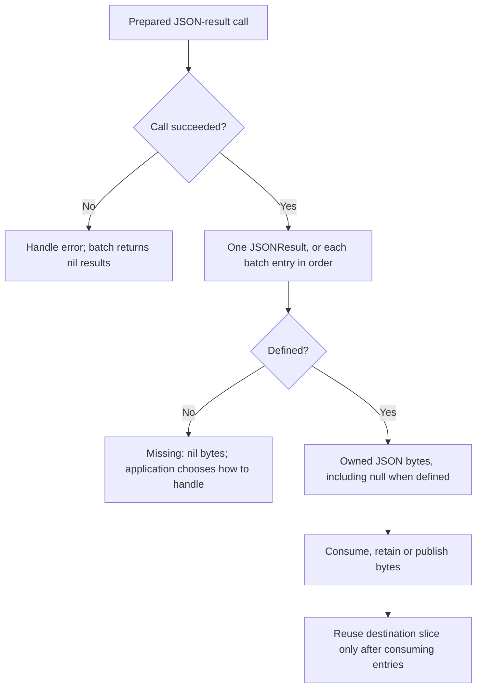

# Prepared JSON results

Introduced in core [v1.2.0](releases/v1.2.0.md). The release notes include
installation from the verified merged commit before the tag is published.

The root package adds two byte-result entry points alongside the existing
`Eval`, `EvalJSON`, `EvalPrepared`, and `Batch.EvalPrepared` APIs:

```go
func EvalPreparedJSON(context.Context, Program, *Document, EvalOptions) (JSONResult, error)
func (*Batch) EvalPreparedJSON(context.Context, *Document, []JSONResult, EvalOptions) ([]JSONResult, error)
```

Compile rules once, select the program or batch for a message subject, and call
`PrepareJSON` once per incoming message. Use the single helper for one rule or
the batch method for fan-out. A document can also be shared across concurrent
calls; each call needs its own destination and stable caller-owned bindings.
The library does not create subscriptions, queues or workers. The application
controls backpressure and publishing. No NATS dependency is required.

JSONPath and JSONata use their native prepared evaluators. Other adapters use
the existing optional `PreparedProgram` capability or receive a detached
materialized value. The optional JavaScript processor works through this
fallback, retaining fresh guest state and its supported execution profile.
No new adapter methods are required.

See the [use-case guide](use-cases.md) for diagrams and examples of single-message
transforms, ordered fan-out, concurrent subject routing and mixed processors.

## Results and ownership

`JSONResult.Value` owns its JSON bytes. A top-level missing result has nil bytes
and `Defined == false`; JSON null has the bytes `null` and `Defined == true`.
JSONPath still returns match lists, including empty and singleton lists.
JSONata retains native shapes and binary64 conversion. JSONPath preserves
selected number spelling. Escaping and isolated UTF-16 surrogates follow the
existing JSON helpers.

Batch results follow expression order. Passing `dst` reuses slice capacity only:
it never overwrites an earlier output's backing byte buffer. Retain a copy of a
`JSONResult` or its `Value` before reusing the destination slice if it is needed
later. Returned buffers can be modified without changing the document, another
result, or future evaluations. Encoding allocates; this API does not promise
zero-copy or zero-allocation processing.



The application may retain an output buffer across destination reuse; each new
encoded result gets independent storage. Undefined entries remain present in
the batch slice, so expression indexes stay stable.

## Limits and errors

Preparation and evaluation remain separate bounded operations. Configured
program and registry limits are combined as in `EvalPrepared`, then nonzero
per-call overrides apply. Explicit unsupported limits are rejected before
adapter evaluation. Input dimensions are rechecked for the evaluation limits.
Bindings and external adapter results are validated and detached.

An expression's timeout starts before evaluation and also covers JSON encoding;
encoding does not receive a fresh timeout. Evaluation and encoding use separate
work counters under that shared deadline and the same dimension limits. A batch
also has the default outer timeout, expression count and input limits, with
per-call overrides. Its output limit counts the sum of actual encoded byte
lengths, including escaping; missing contributes zero bytes, null contributes
four. No enclosing array is encoded. Every expression also retains its own
output limit. Results are encoded sequentially so the batch does not retain an
additional complete set of Go-value results.

On runtime failure the batch returns nil and clears previously populated
destination slots. Other destination contents are unspecified. Preflight
failures, including unsupported options and outer input limits, leave the
destination untouched. Even an empty batch checks those outer input limits.
`BatchError.Index` identifies the failing expression; whole-call preflight errors
may be returned directly. Native diagnostics and cancellation remain available
through `errors.As` and `errors.Is`. Common boundary encoding/conversion errors
have phase `output`; adapter-native diagnostics retain their native phase.

Limits remain cooperative in-process controls. JSON encoding uses bounded
validation and checks cancellation before returning; individual standard-library
marshal operations are not forcibly interruptible. Host functions remain trusted
code and must honor context. This API changes neither those guarantees nor the
JavaScript execution contract.
