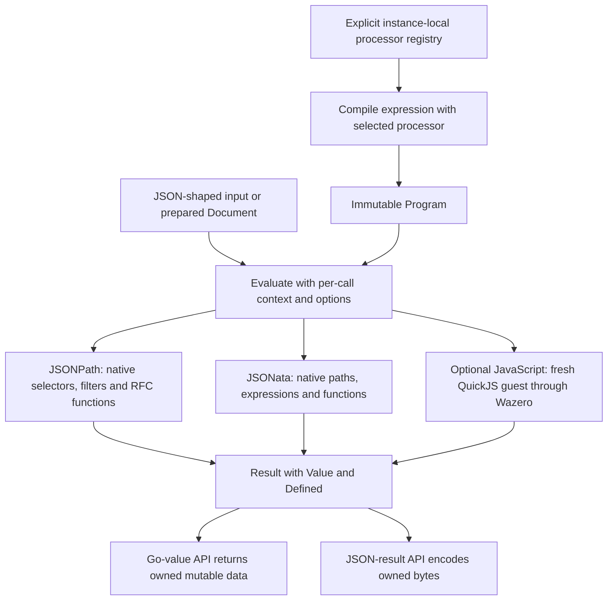

# Processor architecture atlas

The current implementation exposes one processor contract with native JSONPath
and JSONata engines, plus the separately optional production JavaScript module.
Compiled programs and prepared documents are immutable and reusable. Evaluation
state, bindings, budgets and JavaScript guests belong to individual calls.

The branches are alternative processors. A batch evaluates its programs in
order, rather than running these branches concurrently. Native processors can
evaluate prepared documents through their indexed execution paths. The current
JavaScript adapter receives detached materialized JSON input and keeps fresh
guest state for every call.

JSONPath returns match lists and preserves selected numeric spellings. JSONata
preserves native result shapes and uses binary64 numbers at its JSON boundary.
JavaScript accepts synchronous function expressions under its
[supported execution profile](javascript-execution-contract.md); it is not a
Node environment. The native root module has no JavaScript runtime dependency.

For application flows and API selection, see the
[use-case diagrams](use-cases.md) and [prepared JSON-result contract](prepared-json-results.md).

## Editable design checkpoint

The editable [FigJam atlas](https://www.figma.com/board/lTXgmGOWS3Hmh6IQzzmMmB)
records the earlier execution-contract design checkpoint. It contains five
labeled sections:

1. [Shared API](https://www.figma.com/board/lTXgmGOWS3Hmh6IQzzmMmB?node-id=8-500): explicit registry, compilation, input APIs and result shape.
2. [JSONPath](https://www.figma.com/board/lTXgmGOWS3Hmh6IQzzmMmB?node-id=8-502): parser, selectors, filters, RFC functions, exact numbers and match lists.
3. [JSONata](https://www.figma.com/board/lTXgmGOWS3Hmh6IQzzmMmB?node-id=8-504): AST, contexts, sequences, closures, standard library, prepared plans and raw values.
4. [Experimental JavaScript](https://www.figma.com/board/lTXgmGOWS3Hmh6IQzzmMmB?node-id=8-506): owned QuickJS/Wazero, fresh guests, capability limits and this contract PR.
5. [Prepared execution and errors](https://www.figma.com/board/lTXgmGOWS3Hmh6IQzzmMmB?node-id=8-508): reusable documents, native/prepared/fallback dispatch, aggregate limits and error propagation.

Blue/violet identify native engines; amber identifies the JavaScript contract
work at that historical checkpoint. Its experimental/preview JavaScript labels
predate [production approval](javascript-production-readiness.md). QJS wrapper
and Goja remain assessment alternatives, not dependencies of the owned guest.
Tengo is not implemented.

The diagrams explain data/control flow, not mandatory sequential passes through
every language feature. A query need not use regex, closures or every selector.
The [compatibility policy](compatibility.md) and [JS contract](javascript-execution-contract.md)
remain the detailed behavior references.

The implementation now lives in the separate `javascript` module. Its owned
runtime/guest has one canonical copy; assessment alternatives delegate to its
public API. The current Markdown diagrams above and in the use-case guide cover
the additive prepared JSON-result APIs introduced after that checkpoint.
