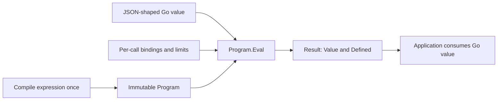
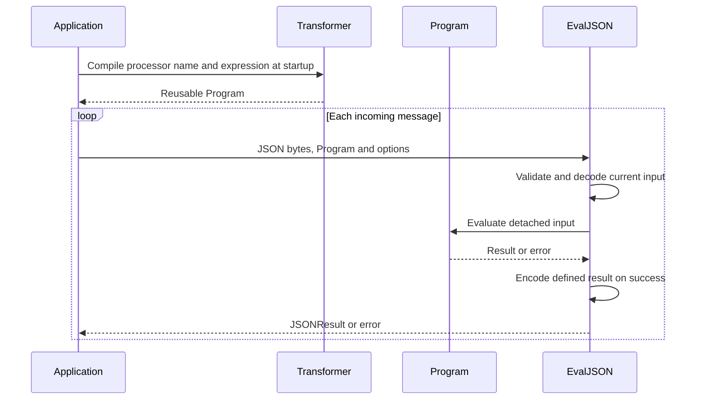
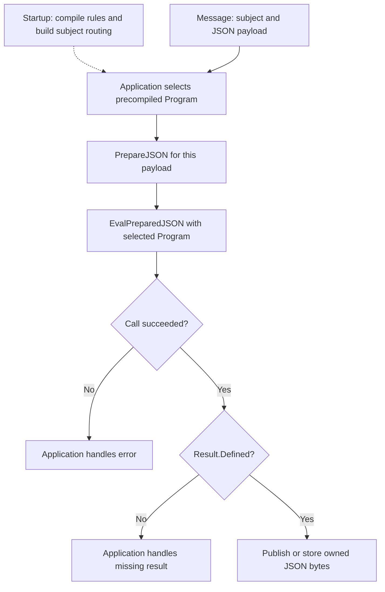
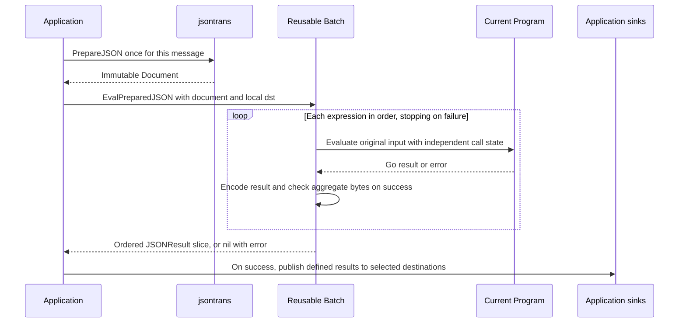
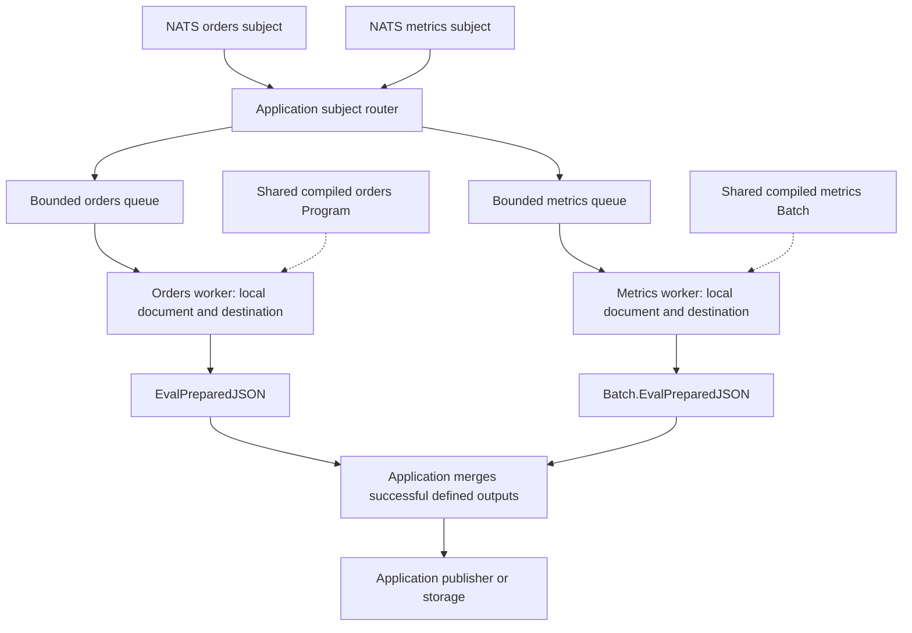
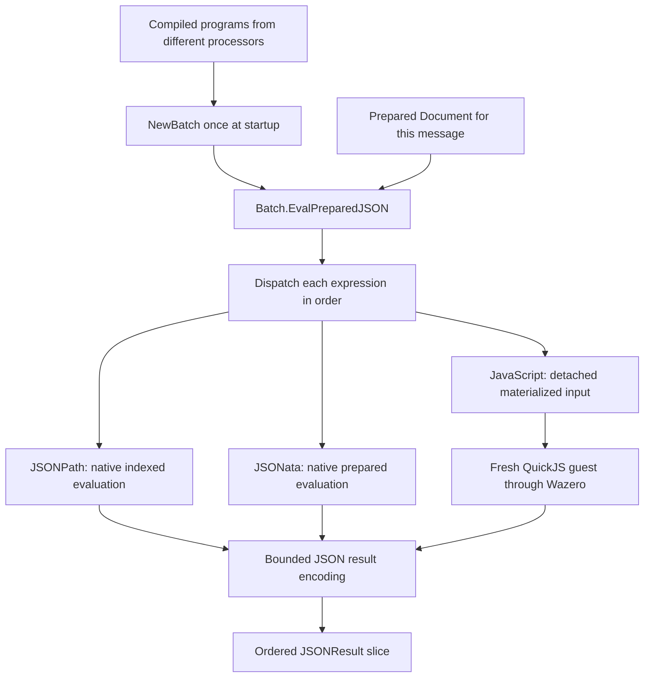

# Use cases and execution flows

Compile predefined expressions at startup and reuse the resulting programs.
Choose an input/output API based on what the application already has and what
it needs to return. The prepared JSON-result helpers are additions; existing
Go-value and fresh-JSON APIs remain available.

| Application has | Application needs | API |
| --- | --- | --- |
| JSON-shaped Go value | One Go result | `Program.Eval` |
| JSON bytes | One encoded result | `jsontrans.EvalJSON` |
| Prepared document | One Go result | `jsontrans.EvalPrepared` |
| Prepared document | Several Go results | `Batch.EvalPrepared` |
| Prepared document | One encoded result | `jsontrans.EvalPreparedJSON` |
| Prepared document | Several encoded results | `Batch.EvalPreparedJSON` |

`Transformer.Process` and `ProcessJSON` combine compilation and evaluation for
one-off calls. `Transformer.Compile` returns one program, `CompileBatch` compiles
an ordered list for one registered processor, and `NewBatch` combines existing
programs, including programs from different processors. There is no automatic
expression cache.

## 1. Transform an existing Go value

Use `Program.Eval` when an application already has a JSON-shaped map, slice or
scalar and needs a Go value back. No JSON serialization step is required by
this API. Inputs remain caller-owned and unchanged; engine-specific numeric
conversion still applies.



JSONPath returns a match list. JSONata preserves native shapes; missing and
defined null remain distinct. See [result semantics](../README.md#results-that-preserve-meaning)
and the [basic example](../examples/basic/main.go).

## 2. Transform fresh JSON bytes with one precompiled rule

`EvalJSON` is the direct byte-input/byte-output helper. It validates and decodes
the current input on each call and encodes a defined result. Compilation is
outside the message loop.



Use this API when direct JSON processing fits the application. Preparing a
document adds indexing work; measure the full preparation-plus-evaluation cost
before selecting a prepared path solely for performance.

## 3. Select one transformation for each message

For a subject-based subscription service, build the subject-to-program mapping
at startup. Select a precompiled program for each message, prepare that
message's bytes, and call `EvalPreparedJSON`. Different messages get different
documents; compilation is reused across them.



In a handler with a selected `program` and current `input`:

```go
document, err := jsontrans.PrepareJSON(ctx, input, jsontrans.PrepareOptions{})
if err != nil {
    return err
}
result, err := jsontrans.EvalPreparedJSON(ctx, program, document, jsontrans.EvalOptions{})
if err != nil {
    return err
}
if !result.Defined {
    return nil // This application chooses to skip missing results.
}
// Pass result.Value to the application's publisher or storage layer.
```

Preparation has its own limits. Pass an appropriate caller context through both
calls when the application needs an overall message deadline. The selected
program's evaluation timeout also covers encoding. Neither helper creates a
subscription or publishes a message.

## 4. Fan out one document through several transformations

Build a `Batch` once for a fixed ordered group of rules, prepare each message
once, and call `Batch.EvalPreparedJSON`. Expressions execute sequentially inside
the batch, sharing the document's immutable index. This is fan-out of results;
it is not a transformation pipeline. Every expression sees the original input,
not the preceding expression's output.



A batch stops at the first failure and returns no partial results. Each defined
value has its own encoded byte buffer; the slice is not one encoded JSON array.
An undefined result retains its position in the slice. `BatchError.Index` maps
a failing expression back to the application's rule list.

Reuse `[]jsontrans.JSONResult` capacity between sequential calls after consuming
its entries. Retain a copy of an entry or its `Value` if needed after the next
call; old byte buffers are not overwritten. Use separate destination slices
for concurrent calls. See the [runnable example](../examples/prepared-json/main.go)
and [ownership and limits](prepared-json-results.md).

Successful batch evaluation does not make multiple external publishes atomic.
The application decides how to handle sink failures and delivery guarantees.

## 5. Process several subjects concurrently and merge outputs

Share immutable programs and batches across application workers. Each active
message has its own document, evaluation state and destination slice. A worker
may reuse its destination capacity after consuming the previous call's results.



The queues, worker count, routing, error handling and merge step belong to the
application. Choose explicit queue bounds and an overload policy. The library
does not impose message ordering across concurrent evaluations or combine
results from different messages. Carry correlation metadata outside the JSON
result if the merge step needs it. Preserve subject ordering in the application
when required.

Compiled programs do not require one transformer instance per worker. Separate
transformers are useful for distinct processor registrations or configuration;
each registry is instance-local. Keep caller-owned bindings stable for the
duration of each call. Registered native Go functions must support concurrent
calls and honor context cancellation.

## 6. Combine processing languages

Use different processors for different subjects, or compile their programs
separately and combine them with `NewBatch`. The common result and error
contracts remain the same, while each engine retains its own language behavior.



The branches show alternative dispatch targets, not parallel execution. The
optional JavaScript module creates fresh runtime state for each evaluation;
sharing a document does not introduce guest pooling. JavaScript retains its
[restricted execution profile](javascript-execution-contract.md) and rejects
explicit unsupported limits, including instruction counts and separate regex
timeouts. A mixed batch checks unsupported limit overrides before executing
any expression.

See the [processor architecture](processor-architecture.md),
[adapter guide](adapters.md), [prepared JSON contract](prepared-json-results.md),
and [optional JavaScript module](../javascript/README.md) for implementation and
extension details. The [public API benchmark record](benchmarks/prepared-json-linux-2026-11-07/README.md)
states exactly which costs its measurements include.
